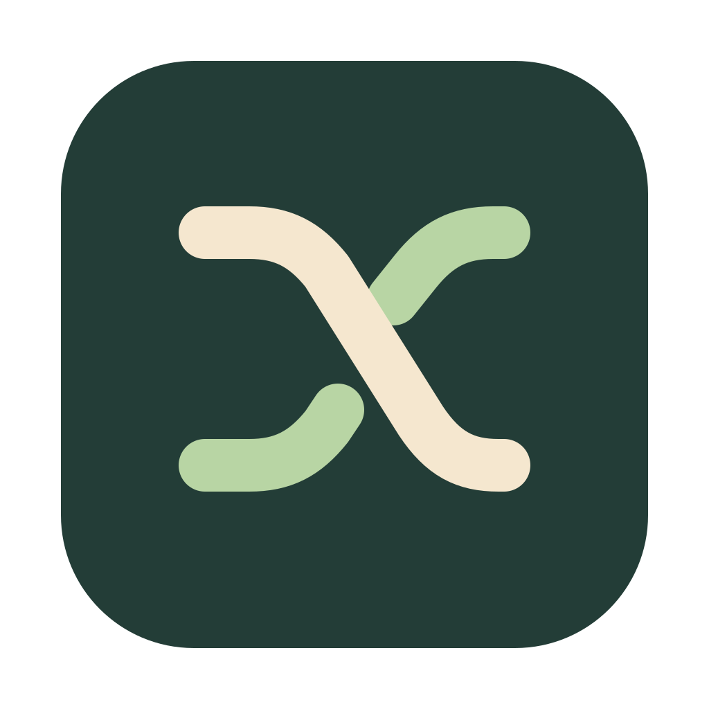
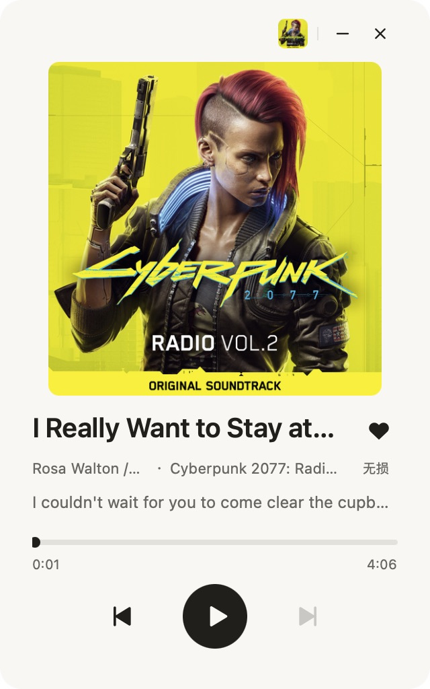

  

<h1 align="center">MusicX</h1>

<strong>Pick a song in chat. Close the window and keep listening.</strong>

MusicX is a native macOS menu bar player with support for media keys and macOS Now Playing.

  

## Highlights

- **Control playback through MCP.** Ask your agent to find songs, play or queue tracks, pause, skip, or adjust the volume. [Connect an MCP client](#connect-an-mcp-client)
- **Add music sources with MyGo plugins.** Browse [MyGo music plugins](https://github.com/topics/mygo-music-plugin) or enter a GitHub repository to add a compatible source. Install them from **Settings → Music Sources**.
- **Low memory usage.** Closing the player window frees its UI memory while a lightweight helper keeps playback and MCP available.

> “Play a track by Jay Chou and queue two more.”

## Install MusicX

MusicX requires macOS 14 or later. The first notarized download is in preparation. Published builds will appear on [GitHub Releases](https://github.com/popomore/MusicX/releases).

1. Open the `MusicX-macos-*.dmg` for your Mac.
2. Drag **MusicX** to **Applications** and open it there.
3. Use the MusicX menu bar icon to reopen the player after closing the window.

MusicX starts without a default music source. Add a plugin from **Settings → Music Sources** before searching or playing music; installed sources work independently of catalog availability. A dot on the menu bar icon indicates playback. Right-click and choose **Quit MusicX**, or press Command-Q with the panel focused, to end the session.

Release builds check for stable updates daily and download them in the background using Sparkle. Open **Settings → Version & Updates** to see your version and check immediately, or choose **Check for Updates…** from the MusicX application menu or the menu bar icon's right-click menu. Update installation and restart are handled by Sparkle. Development and ad hoc builds do not enable automatic updates. Ad hoc releases remain available for download but are not marked Latest.

## A player that fits in the menu bar

- **See what's playing.** Open the album from the cover, follow timed lyrics, or choose Standard, High, or Lossless from the quality badge.
- **Keep your place.** Pick a track from an album, playlist, or history to play that collection in order. History saves progress for each play.
- **Make it yours.** Save tracks with the heart, organize local playlists, and import playlists from supported MyGo sources. Manage sources and sign-in under **Settings → Music Sources**.

## Connect an MCP client

Open **Settings → MCP Connection** in MusicX and choose **Copy MCP Configuration**. Paste the configuration into a client that supports Streamable HTTP. If your client asks for separate fields, use the address shown in MusicX and **Copy Token** to supply the bearer token.

The client can search, play, queue, seek, and work with sources, local playlists, and playback history. [MCP tool reference](docs/DEVELOPMENT.md#mcp-tools)

## Local data

MusicX saves accounts, preferences, playlists, history, and the MCP token in `~/Library/Application Support/MusicX/`. Installed plugins live in `mygo-plugins/`.

MusicX uses only its current data directory and application identity. Previous application identities, environment names, and data directories are not imported or migrated. Existing files elsewhere are left untouched.

## Project guides

[Development guide](docs/DEVELOPMENT.md) · [Design guide](docs/DESIGN.md) · [Product overview](docs/PRODUCT.md) · [iPhone build guide](apps/ios/README.md)

[Plugin capabilities and MyGo differences](docs/PLUGINS.md)

## Acknowledgments

Thank you to [MyGo Music](https://github.com/egoist/mygo-music), its authors, and the plugin contributors for the plugin APIs and ecosystem that MusicX supports. Browse [MyGo music plugins](https://github.com/topics/mygo-music-plugin) or read the [MyGo plugin development guide](https://github.com/egoist/mygo-music#plugins).

## License

MusicX is licensed under the [MIT License](LICENSE). Third-party dependencies and vendored code retain their respective licenses.
