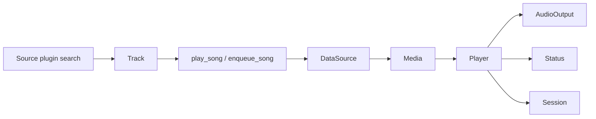

# MusicX Design Guide

MusicX keeps the current track in focus. The macOS panel is a transient view of the playback session owned by MusicX Helper. System Now Playing, media keys, and MCP operate on that same session.

## macOS layout

- Use the warm surface and text colors in `assets/theme.json`, with system typography and album artwork as the main visual. The compact window is 320 × 512 points, with 24-point content insets and 248-point square artwork.
- Before the first session snapshot arrives, show a connection state. A confirmed empty session shows the MusicX mark and focuses on adding a music source, with one prominent add-source button. A smaller Agent connection entry explains choosing music and controlling playback through conversation. Playlists remain available in details navigation. Hide artwork placeholders, track metadata, lyrics and transport controls until there is a current track. Keep this setup available for returning users with an empty queue as well.
- Keep track titles prominent. Place the artist and the linked album on one line and anchor the audio quality badge at the trailing edge. Use a tint on hover and a pressed state to identify clickable text. The title opens song information and the large cover opens the album.
- Use a solid circular play or pause button and monochrome symbols for adjacent controls. Provide accessible labels and visible selected, pressed, and disabled states.
- The MusicX mark consists of two crossing audio tracks. Its menu bar version is a fixed-width monochrome symbol. A small dot indicates playback and the tooltip carries the track and playback state. Regenerate the artwork with `sh assets/build-icons.sh`.

## Details and navigation

Use native AppKit menus in the order MusicX, Edit, Playback, View, Window, Help. Keep system actions and text editing on the responder chain. Group related commands with separators, show standard keyboard equivalents, check the current View destination and Mini Lyrics preference, and disable commands without an available playback session. Playback navigation uses the same details pane as the toolbar. Settings uses Command-comma to open its own window, and Music Sources opens the corresponding settings group. Labels refresh when the interface language changes.

The compact title bar keeps a drag area with minimize and close controls. Open details from the hover edge or View menu. The details toolbar switches between Now Playing, History, and My Playlists.

The 296-point details pane opens beside the 320-point player with a 12-point transparent gap. Both panes share one native window. Choose the side with more room on the current display, preferring the right on a tie. Keep the selected side while switching views and keep the main controls available throughout.

While compact, reserve a 24-point target along the chosen opening edge. Hover or keyboard focus reveals a translucent rounded grip with an outward chevron; clicking opens Now Playing. Hide the hint while details are open. Recompute its side after native window movement and screen changes using the same geometry as the actual opening. The hint stays inside the player and adds no window resizing or motion.

Expand the host before sliding the pane outward from the player: left details move left to open and right to close; right details do the reverse. Clip motion to the details region so the player and transparent gap stay clear, and shrink the host after the pane slides back toward the player. Escape, the close control, and the gap dismiss details. An interrupted entrance returns to the compact size. Honor the system Reduce Motion setting.

Both the NSWindow and its NSH host container must be transparent so the desktop shows through the rounded corners and the gap. Check this on a colored desktop or with native layer inspection.

## Playback views

- **Queue.** Show the queue name, source type, and track count. Mark the active position with a subdued fill and a play or pause symbol. Locate the current track on entry, then let the listener browse freely and provide a way to return to it.
- **Lyrics.** Keep one line in the player and use a separate details view for the full lyrics. Parse LRC timestamps, align translations by time, and allow seeking by line while preserving play or pause state. Scrolling pauses follow mode. Provide a return-to-current control and present untimed lyrics as plain text.
- **Track information.** Show the song, artist, album, source link, and an action to add the track to a local playlist. Use album details for the album's track list.
- **Audio quality.** Anchor the popover to the badge. Separate the reported stream format and bitrate from the user's preference. Treat missing fields as unknown. During a quality switch, show its state and hold the requested seek position until the audio engine completes the seek. An older seek callback must never overwrite a newer position.
- **Playback notices.** Use one compact entry beside the current track title. Warnings such as unencrypted HTTP audio or missing artwork use a muted triangle; errors use a red circular error icon and take priority. List each reason with its own severity icon in the popover. Open a new error once, allow dismissal and reopening, and clear resolved notices. Keep status and error text out of the transport footer. Show track resolution and buffering inside the play button with a loading indicator, honoring Reduce Motion; keep empty-session errors visible. Transport state stays out of stable track metadata.

## Playlists and sources

Use full-row buttons with a title and secondary metadata for track lists. Use small thumbnails with a musical placeholder for missing artwork. Queue, history, album, and local playlist tracks use 36-point covers on macOS. Playlist summaries use 40-point covers. Source playlists use the artwork provided by the plugin. Local playlist previews use the first available track cover.

My Playlists opens in browse mode. Show the name, track count, and common play or add actions. Put rename, remove, and delete in management mode, with a clear way to finish. Show an inline name field when creating a playlist. The heart beside the track title toggles Liked Songs and remains in sync with edits to that playlist.

On macOS, settings uses a separate 704 × 520-point native window with a 184-point sidebar and a 640 × 440-point minimum content size. Its sidebar orders Language, Playback, Music Sources, Agent, and Version & Updates. Show one group at a time, with a clear selected row, a 20-point heading, and 28-point content insets. Repeated opens reuse the window; each window closes independently and the UI process exits after the last window closes. The empty player's add-source and Agent actions open the corresponding settings group without expanding details. The iPhone keeps its existing scrollable settings flow.

Escape closes Settings when the focused control does not consume it. Keep this shortcut available after language changes and leave the player open.

Agent provides one automatic setup row each for Codex and Claude Code, with a disabled busy state and inline success or error feedback. Keep the MCP endpoint and copy actions below them for manual setup. Automatic setup updates only MusicX's connection in the agent's user configuration, preserves other servers and tool approval settings, backs up an existing file, and saves atomically. Do not overwrite malformed configuration or show its contents in errors.

Minimizing or hiding the player keeps its view state available when settings closes. Source browsing and imported-playlist navigation from settings target the player's model. Each source browser owns its sign-in job and cancels only that job when it closes; process shutdown cancels all remaining jobs.

Use 36-point rows with trailing switches for playback and “自动更新插件”, 48-point source rows with a disclosure indicator, and an add action beside the Music Sources heading. The plugin update switch is enabled by default and explains daily repository checks and account/settings preservation; keep it disabled until its saved value is loaded. Keep related controls 4–8 points apart. The MCP section groups the local endpoint, compact copy actions, and inline feedback. Keep the version and update action on one row, with the label “检查更新”. Below it, “接收更新” offers “全部版本” and “稳定版” using the same compact selection buttons as playback quality. Stable is selected initially; the all-versions caption explicitly includes Preview. Source details show configuration fields, account actions, and import options according to capabilities. The add-source catalog shows compatibility and reasons an action is unavailable. Use secure fields for credentials and offer replacement controls for saved secrets. Cancel an unfinished sign-in when its view closes. Web sign-in runs in a temporary WebKit process and shows the website's domain.

## Data models

The source adapter, player, local library, and UI have different ownership. Shared wire types live in `crates/protocol`; a UI snapshot is not another owner of the listening session.

| Model | Responsibility | Owner |
| --- | --- | --- |
| `Source` | A track locator: plugin ID plus the original string track ID. | Shared protocol |
| `Track`, `Album`, `SourceLink` | Stable music metadata: title, artist, duration in seconds, artwork, album and source references. No resolved audio URL or credentials. | Shared protocol |
| `Media` | A resolved playback request: full `Track`, temporary audio URL, supported headers and actual stream quality. | `crates/plugin-api` |
| `Quality`, `AudioQuality` | Listener preference versus the actual source-reported format, bitrate, sample rate and bit depth. A preference never substitutes for measured/reported metadata. | Shared protocol / `crates/core` |
| `Player`, `Action`, `Message` | The authoritative listening session and its commands: queue, current position, volume, playback transitions and asynchronous resolution. | `crates/core` |
| `Status`, `QueueContext` | A session snapshot for clients and the origin of its independent queue snapshot. | Shared protocol |
| `Session` | Durable queue, index, context, position and volume checkpoint. A restart restores paused and obtains a fresh stream on Play. | `crates/core` |
| `LocalPlaylist`, `PlaylistOrigin` | Player-owned saved tracks, revisions, favorite/pinned state and optional import provenance. A local edit never changes the source playlist. | `crates/core` / shared protocol |
| `HistoryEntry`, `HistoryProgress` | Each recorded play and its position, duration and completion state, separate from the current queue. | `crates/core` / shared protocol |
| `MusicSource`, `MusicSourceCatalog` | Plugin descriptions, installation/compatibility state, capabilities, settings and discovery refresh state. | `crates/plugins` / shared protocol |
| `SourceAccount`, `SourceLogin`, `SourcePlaylist` | Source-provided account state, temporary sign-in jobs and remote playlist descriptions. These do not own the player's session. | `crates/plugins` / shared protocol |

`Source` identifies a track, `MusicSource` describes an installed or discoverable plugin, and `PlaylistOrigin` records where a local import came from. They are not interchangeable. The numeric `Track.id` remains for existing records; current source identity is carried by `Source(plugin, id)`, and a bare number never selects a source.

`DataSource` resolves playable media and supplies track/album information; it does not control the queue. `AudioOutput` implements platform playback without knowing plugin installation or account flows. The player also uses `DataSource` to obtain fresh media when resuming, advancing or changing quality. The panel's `Model` and browser signals are disposable view state, not a second player or persistent library.

## Runtime boundaries

- `crates/core` owns session state and persistence. The core drives audio through `AudioOutput` and obtains media through `DataSource`. `crates/protocol` holds the shared types.
- `crates/platform-apple` adapts playback to AVPlayer and publishes system Now Playing metadata. The macOS helper assembles the platform, plugin bridge, and MCP service.
- MCP source tools discover music and return the shared `Track` type. Independent `play_song`/`enqueue_song` player tools accept that complete track and resolve through the injected `DataSource`; they do not invoke a concrete source plugin.
- `crates/plugin-api` defines the Rust source contract. `crates/plugins` adapts MyGo plugins and handles source configuration and accounts. `crates/mcp` exposes player actions and the panel's local routes.
- Fetch the full queue when its version changes and render only visible rows in long lists. Share playback progress with lyrics and run the lyric display timer only when needed. Limit the panel's artwork cache to 4 MiB and release its resources on close.
- The distributed macOS app ships the panel and web sign-in components inside its bundle. Source builds stage their app bundles under `runtime/` in `~/Library/Application Support/MusicX/`. Installed plugins live under `mygo-plugins/` in the same data directory. The iPhone app uses its own sandbox. [Local data](../README.md#local-data)
